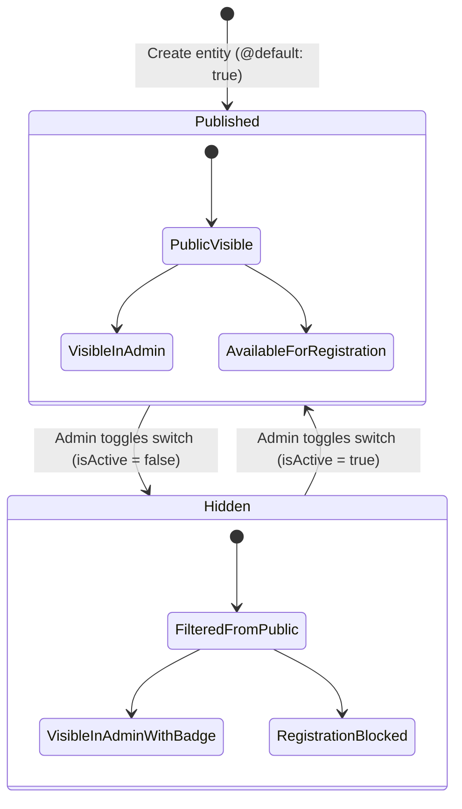

# Data Model & Schema Specification: Soft Visibility & Publish Toggle

**Feature**: Soft Visibility & Publish Toggle for Players, Training Courses & Scrimmages  
**Spec**: [`specs/004-content-visibility-toggle/spec.md`](spec.md)  
**Date**: 2026-11-07  

---

## 1. Database Schema Definitions (`prisma/schema.prisma`)

### A. Model `Player`

```prisma
model Player {
  id              String             @id @default(uuid())
  userId          String?            @unique
  user            User?              @relation(fields: [userId], references: [id], onDelete: SetNull)

  fullName        String
  jerseyNumber    Int
  height          Float              // Chiều cao (cm)
  weight          Float              // Cân nặng (kg)
  spikeTouch      Float              // Tầm bật đà (cm)
  blockTouch      Float              // Tầm bật chắn (cm)
  hometownCountry String             // Quê quán / Thành phố (VD: "Hà Nội")
  countryName     String?            @default("Vietnam")
  countryCode     String             @default("VN")
  countryFlag     String?            @default("🇻🇳")
  bornYear        Int?
  level           PlayerLevel        @default(JUNIOR)
  position        VolleyballPosition @default(OH)
  avatarUrl       String?
  bio             String?            @db.Text
  isCaptain       Boolean            @default(false)
  joinedYear      Int                @default(2025)
  isActive        Boolean            @default(true) // Soft visibility flag (Public vs Admin)

  createdAt       DateTime           @default(now())
  updatedAt       DateTime           @updatedAt

  @@index([level, position])
  @@index([jerseyNumber])
  @@index([level, isCaptain(sort: Desc), jerseyNumber(sort: Asc)])
  @@index([level, fullName(sort: Asc)])
  @@index([isActive])
  @@map("players")
}
```

### B. Model `TrainingCourse` (Covers Courses & Scrimmages)

```prisma
model TrainingCourse {
  id             String                 @id @default(uuid())
  title          String
  level          String
  tag            String?
  targetAudience String                 @db.Text
  price          Int                    // Học phí / Phí tham gia (VND)
  priceUnit      String?                // VD: "/ player / session"
  schedule       String
  duration       String

  coachId        String?
  coach          CoachProfile?          @relation(fields: [coachId], references: [id], onDelete: SetNull)
  coachName      String
  coachTitle     String

  description    String                 @db.Text
  benefits       String[]
  curriculum     String[]
  maxSlots       Int                    @default(16)
  enrolledSlots  Int                    @default(0)
  imageUrl       String?
  isActive       Boolean                @default(true) // Soft visibility flag (Public vs Admin)

  // Relations
  registrations  TrainingRegistration[]

  createdAt      DateTime               @default(now())
  updatedAt      DateTime               @updatedAt

  @@index([isActive])
  @@map("training_courses")
}
```

---

## 2. TypeScript Domain Models (`src/types/index.ts`)

```typescript
export interface Player {
  id: string;
  userId?: string;
  fullName: string;
  jerseyNumber: number;
  height: number;
  weight: number;
  spikeTouch: number;
  blockTouch: number;
  hometownCountry: string;
  country?: string;
  countryName?: string;
  countryCode?: string;
  countryFlag?: string;
  bornYear?: number;
  level: PlayerLevel;
  position: VolleyballPosition;
  avatarUrl?: string;
  bio?: string;
  isCaptain?: boolean;
  captain?: boolean;
  joined?: string | number;
  joinedYear?: number;
  isActive?: boolean; // Soft visibility toggle (true = published, false = hidden)
}

export interface TrainingCourse {
  id: string;
  title: string;
  level: string;
  coachName: string;
  coachTitle: string;
  schedule: string;
  duration: string;
  price: number;
  priceUnit?: string;
  tag?: string;
  benefits?: string[];
  description: string;
  targetAudience: string;
  curriculum: string[];
  maxSlots: number;
  enrolledSlots: number;
  imageUrl?: string;
  isActive?: boolean; // Soft visibility toggle (true = published, false = hidden)
}
```

---

## 3. DTO Normalization Layer (`lib/prisma.ts`)

```typescript
export function toPlayerDto(p: DbPlayer | any): Player {
  // ... existing field normalization ...
  return {
    // ... other properties ...
    isActive: p.isActive !== false,
  };
}

export function toCourseDto(c: DbTrainingCourse): TrainingCourse {
  // ... existing field normalization ...
  return {
    // ... other properties ...
    isActive: c.isActive !== false,
  };
}
```

---

## 4. Schema Sanitization & Validation (`lib/schemas.ts`)

```typescript
export const VISIBILITY_TOGGLE_SCHEMA: Schema = {
  isActive: B,
};

// Add isActive to existing schemas
export const PLAYER_SCHEMA: Schema = {
  // ... existing rules ...
  isActive: B,
};

export const COURSE_SCHEMA: Schema = {
  // ... existing rules ...
  isActive: B,
};
```

---

## 5. State Lifecycle & Transitions



### Relational Integrity Guarantees
- **No Cascade Deletions**: Hiding an entity keeps all foreign keys (`TrainingRegistration.courseId`, `User.id`) valid and intact.
- **Reporting Stability**: Historical revenue, booking history, and registration logs reflect accurate historical data regardless of current visibility state.
